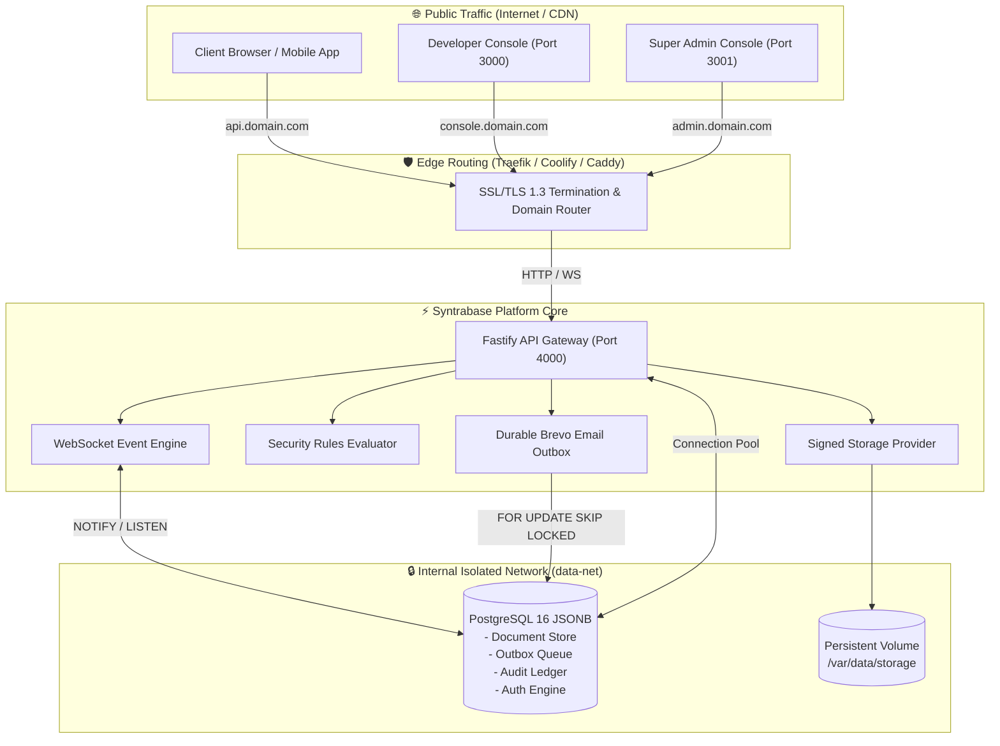

<div align="center">

  

  # Syntrabase

  <p>
    <strong>The Self-Hosted, Multi-Tenant Firebase Alternative Built for Production</strong>
  </p>
  <p>
    PostgreSQL JSONB • Fastify • Next.js 14 • Coolify • Zero Cloud Vendor Lock-In
  </p>

  <p>
    <a href="#-quickstart-coolify-1-click"></a>
    <a href="https://github.com/Animeki004/Syntrabase/blob/main/LICENSE"></a>
    <a href="https://nodejs.org"></a>
    <a href="https://www.postgresql.org"></a>
    <a href="https://typescriptlang.org"></a>
  </p>

  <p>
    <a href="#-key-features">Features</a> •
    <a href="#-architectural-topology">Architecture</a> •
    <a href="#-quickstart-coolify-1-click">Coolify Guide</a> •
    <a href="#-local-production-launch">Production Start</a> •
    <a href="#-sdk-integration">SDK Setup</a> •
    <a href="#-security-and-cryptography">Security</a> •
    <a href="#-license">License</a>
  </p>

  <hr style="border: 0; height: 1px; background-image: linear-gradient(to right, rgba(0, 0, 0, 0), rgba(99, 102, 241, 0.75), rgba(0, 0, 0, 0)); margin: 24px 0;" />

</div>

---

## 🌟 Why Syntrabase?

Google Firebase offers exceptional developer ergonomics, but brings **unpredictable bills**, proprietary API lock-in, and strict cloud quota ceilings. 

**Syntrabase** delivers the exact modular Firestore, Auth, Storage, and Realtime developer workflow you love, powered entirely by an authoritative **PostgreSQL 16 JSONB** foundation that you own, inspect, and host anywhere (Coolify, Hetzner, AWS, DigitalOcean, or private VPS).

<br />

| Feature Capability | Google Firebase | Syntrabase |
| :--- | :---: | :---: |
| **Hosting Freedom** | ❌ Google Cloud Only | ✅ **100% Self-Hosted (Coolify, Docker, Bare Metal)** |
| **Database Engine** | ⚠️ Proprietary NoSQL | ✅ **PostgreSQL 16 JSONB + GIN Indexing** |
| **Direct SQL Queries** | ❌ Impossible | ✅ **Full Direct PostgreSQL / DDL Access** |
| **Bill Predictability** | ❌ Uncapped Pay-Per-Read | ✅ **Fixed VPS Cost ($5/mo for 10M+ operations)** |
| **Outbound Email Engine** | ⚠️ Complex Cloud Functions | ✅ **Built-in Brevo HTTPS API + Custom DNS Management** |
| **Storage Security** | ⚠️ Opaque Rules | ✅ **HMAC-Signed URLs + Strict CSP & nosniff Protection** |
| **Multi-Tenant Consoles** | ⚠️ Single Dashboard | ✅ **Developer Console (:3000) & Super Admin Command (:3001)** |
| **Audit Compliance** | ⚠️ Paid Cloud Logging | ✅ **Tamper-Evident Cryptographic HMAC Audit Ledger** |

---

## 🚀 Key Features

<table>
  <tr>
    <td width="50%" valign="top">
      <h3>⚡ PostgreSQL JSONB Document Engine</h3>
      <ul>
        <li><strong>ACID Document Store</strong>: High-throughput JSONB with GIN indexing (<code>jsonb_path_ops</code>).</li>
        <li><strong>Subcollections & Compounds</strong>: Native support for subcollection hierarchies and multi-field compound filters.</li>
        <li><strong>Interactive Transactions</strong>: <code>SELECT ... FOR UPDATE</code> with concurrency conflict detection and jittered backoff.</li>
        <li><strong>Server Transforms</strong>: <code>serverTimestamp</code>, <code>increment</code>, <code>arrayUnion</code>, <code>arrayRemove</code>.</li>
      </ul>
    </td>
    <td width="50%" valign="top">
      <h3>🛡️ Declarative Security Rules</h3>
      <ul>
        <li><strong>AST Compilation</strong>: High-speed Abstract Syntax Tree evaluator supporting <code>request.auth</code> and <code>resource.data</code>.</li>
        <li><strong>Monaco Code Studio</strong>: In-browser editor with syntax highlighting, token simulation, and 1-click live publishing.</li>
        <li><strong>Version History</strong>: Snapshot versioning with instant rollback and audit tracking.</li>
      </ul>
    </td>
  </tr>
  <tr>
    <td width="50%" valign="top">
      <h3>📬 Transactional Email Infrastructure</h3>
      <ul>
        <li><strong>Brevo HTTPS API Engine</strong>: Cloud-native port 443 dispatch (bypasses ISP port 25 blocking on Oracle/Hetzner).</li>
        <li><strong>Durable Outbox Queue</strong>: Concurrent processing with <code>FOR UPDATE SKIP LOCKED</code> and circuit breakers.</li>
        <li><strong>Custom Sender Domains</strong>: Full DKIM TXT, SPF TXT, MX records and 1-click Cloudflare DNS synchronization.</li>
        <li><strong>AES-256-GCM Vault</strong>: Hardware-accelerated encryption of email provider credentials.</li>
      </ul>
    </td>
    <td width="50%" valign="top">
      <h3>🗄️ Fortified Signed Storage</h3>
      <ul>
        <li><strong>Cryptographic Signed URLs</strong>: Expiring HMAC tokens with instant path traversal containment.</li>
        <li><strong>Defense-in-Depth Headers</strong>: Enforces <code>X-Content-Type-Options: nosniff</code> and <code>Content-Security-Policy: default-src 'none'</code>.</li>
        <li><strong>Plan Capacity Enforcement</strong>: Authoritative real-time storage quotas preventing rogue consumption.</li>
      </ul>
    </td>
  </tr>
  <tr>
    <td width="50%" valign="top">
      <h3>🎛️ Dual Production Consoles</h3>
      <ul>
        <li><strong>Developer Console (Port 3000)</strong>: Next.js 14 App Router, live database studio, storage explorer, and API key rotation.</li>
        <li><strong>Super Admin Center (Port 3001)</strong>: Multi-tenant fleet control, plan quotas, disaster recovery drills, and security posture.</li>
        <li><strong>Zero Mock Terminology</strong>: Professional support ticket workflows with "Syntrabase Support Team" masking.</li>
      </ul>
    </td>
    <td width="50%" valign="top">
      <h3>📦 Modular SDK Ecosystem</h3>
      <ul>
        <li><strong>Client SDK (<code>@syntrabase/client-sdk</code>)</strong>: Drop-in modular Firebase v9/v10 syntax with tree-shaking and offline caching.</li>
        <li><strong>Admin SDK (<code>@syntrabase/admin-sdk</code>)</strong>: Privileged Node.js server SDK for backend microservices and automated jobs.</li>
      </ul>
    </td>
  </tr>
</table>

---

## 🏗️ Architectural Topology



---

## 📁 Repository Structure

```text
syntrabase/
├── apps/
│   ├── api/                   # Fastify HTTP REST & WebSocket Gateway (:4000)
│   ├── console/               # Developer Console — Next.js 14 App Router (:3000)
│   └── super-admin/           # Super Admin Command Center — Next.js 14 (:3001)
├── packages/
│   ├── client-sdk/            # Modular Firebase v9/v10 Client SDK
│   ├── admin-sdk/             # Node.js Privileged Server Admin SDK
│   ├── rules-engine/          # AST Security Rules Compiler & Evaluator
│   ├── schemas/               # Shared Zod validation schemas
│   └── shared-types/          # Universal TypeScript interfaces
├── infrastructure/
│   ├── database/migrations/  # PostgreSQL DDL migrations (001 - 009)
│   ├── docker/                # Multi-stage production Dockerfiles
│   └── caddy/                 # Production Caddyfile configuration
├── scripts/
│   └── start-production.js    # Production cluster launcher (API + Consoles)
├── docker-compose.yml         # Coolify & production Docker topology
└── .env.example               # Pre-seeded cryptographic environment template
```

---

## 🚀 Quickstart: Coolify 1-Click Deployment

Syntrabase is designed natively for zero-friction deployment on [Coolify](https://coolify.io).

### 1. Configure DNS Records
At your domain registrar (e.g. Cloudflare, Namecheap), point 3 A-records to your VPS IP:
* `api.yourdomain.com` $\rightarrow$ `YOUR_VPS_IP`
* `console.yourdomain.com` $\rightarrow$ `YOUR_VPS_IP`
* `admin.yourdomain.com` $\rightarrow$ `YOUR_VPS_IP`

### 2. Deploy in Coolify
1. In your Coolify dashboard, click **+ Add Resource** $\rightarrow$ **Docker Compose**.
2. Select your repository (`https://github.com/Animeki004/Syntrabase`), branch `main`.
3. Set **Docker Compose Location** to `/docker-compose.yaml` (or `/docker-compose.yml`).
4. In the **Environment Variables** tab, configure your domain names and secrets (or copy pre-seeded high-entropy keys from [`.env.example`](./.env.example)):
   ```ini
   NODE_ENV=production
   PLATFORM_DOMAIN=yourdomain.com

   # Coolify Traefik Routing Domains
   API_DOMAIN=api.yourdomain.com
   CONSOLE_DOMAIN=console.yourdomain.com
   ADMIN_DOMAIN=admin.yourdomain.com

   # PostgreSQL Database Credentials
   DATABASE_NAME=syntrabase
   DATABASE_USER=postgres
   DATABASE_PASSWORD=your_secure_postgres_password_here

   # Cryptographic Authentication & Security Keys
   JWT_SECRET=your_jwt_secret_key_minimum_64_characters_long
   PASSWORD_PEPPER=your_password_pepper_32_characters_long
   CREDENTIALS_ENCRYPTION_KEY=your_credentials_encryption_key_32b
   AUDIT_HMAC_SECRET=your_audit_hmac_secret_sha256_key_here

   # Platform Super Admin Initial Credentials
   PLATFORM_ADMIN_EMAIL=admin@yourdomain.com
   PLATFORM_ADMIN_PASSWORD=your_super_admin_secure_password_here
   ```
5. Click **Deploy**. Coolify will automatically create persistent volumes, run migrations, compile production images, and provision SSL certificates via Traefik.

---

## 💻 Local Production Launch

You can run the entire production cluster locally without Docker:

```bash
# 1. Clone the repository
git clone https://github.com/Animeki004/Syntrabase.git
cd Syntrabase

# 2. Install dependencies
npm install

# 3. Build optimized bundles across all workspaces
npm run build

# 4. Start the production cluster directly
npm start
```

```text
========================================================
  SYNTRABASE PRODUCTION CLUSTER LAUNCHER
========================================================

Starting API GATEWAY (Production) on port 4000...
Starting CONSOLE (Production) on port 3000...
Starting SUPER ADMIN (Production) on port 3001...
[API GATEWAY] Server listening on http://0.0.0.0:4000
[CONSOLE]  ✓ Ready in 800ms
[SUPER ADMIN]  ✓ Ready in 780ms
```

---

## 📦 SDK Integration

Syntrabase provides modular client and server SDKs that mirror Firebase v9/v10:

### Client SDK (`@syntrabase/client-sdk`)

```typescript
import { initializeApp } from '@syntrabase/client-sdk';
import { getAuth, signInWithEmailAndPassword } from '@syntrabase/client-sdk/auth';
import { getFirestore, collection, doc, setDoc, getDoc } from '@syntrabase/client-sdk/firestore';

const app = initializeApp({
  apiKey: "pk_live_default_key_syntrabase_2026",
  projectId: "default-project",
  apiBaseUrl: "https://api.yourdomain.com",
});

// Authenticate Developer User
const auth = getAuth(app);
await signInWithEmailAndPassword(auth, "developer@example.com", "SecretPass123!");

// Firestore-compatible JSONB document write
const db = getFirestore(app);
await setDoc(doc(db, "projects", "proj_alpha"), {
  title: "Syntrabase Engine",
  tier: "enterprise",
  active: true,
  createdAt: new Date().toISOString(),
});
```

### Admin SDK (`@syntrabase/admin-sdk`)

```typescript
import { initializeAdminApp } from '@syntrabase/admin-sdk';
import { getAdminFirestore } from '@syntrabase/admin-sdk/firestore';

const adminApp = initializeAdminApp({
  projectId: "default-project",
  serviceAccountKey: "sk_live_syntrabase_secret_master_key",
  apiBaseUrl: "https://api.yourdomain.com",
});

const adminDb = getAdminFirestore(adminApp);
// Bypasses security rules for privileged background processing
await adminDb.collection("audit_reports").add({
  type: "DAILY_SNAPSHOT",
  verified: true,
});
```

---

## 🔒 Security and Cryptography

* **Multi-Layered Password Hashing**: Passwords undergo salted `scrypt` key derivation combined with a server-side 256-bit `PASSWORD_PEPPER`.
* **Zero-Trust Super Admin Authorization**: Every privileged operation enforces real-time database lookup against the `platform_admins` table; static JWT claims are never trusted blindly.
* **Tamper-Evident Audit Ledger**: Every administrative change creates an immutable row verified with HMAC-SHA256 chaining.
* **Storage Path Containment**: Storage downloads enforce strict root boundary containment checks to eliminate directory traversal attacks (`../`).
* **Content Security Policy**: Download endpoints force `default-src 'none'`, `X-Content-Type-Options: nosniff`, and `X-Frame-Options: DENY`.

---

## 📜 License

Distributed under the **MIT License**. See [`LICENSE`](./LICENSE) for full details.

<div align="center">
  <br />
  <p>
    Built with ❤️ by <strong><a href="https://github.com/Animeki004">Mr. Developer</a></strong>
  </p>
</div>
